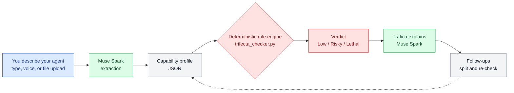

# Trifecta Checker

[English](README.md) · [日本語](README.ja.md) · [中文](README.zh.md) · **हिन्दी** · [Español](README.es.md) · [한국어](README.ko.md)

**एआई एजेंटों के लिए उड़ान-पूर्व सुरक्षा जांच।** बताइए कि आपका एजेंट क्या-क्या कर सकता है — Trifecta Checker आपको बताएगा कि शक्तियों का वह मेल सुरक्षित है या नहीं, क्यों है, और सुरक्षित न होने पर उसे कैसे बांटा जाए।

मेटा ग्लोबल एआई डेवलपर हैकाथॉन (अक्टूबर–नवंबर 2026) के लिए निर्मित।

<p align="center">
  
  <br>
  <sub>Trafica, Trifecta Checker का शुभंकर</sub>
</p>

**लाइव डेमो:** https://meta-global-ai-hackathon-trifecta-c.vercel.app/

## उपयोग का अनुभव कैसा है

आप **Trafica** से बात करते हैं, जो एक मिलनसार जांच सहायक है — न कोई फॉर्म भरना है, न सुरक्षा की शब्दावली जाननी है:

1. **अपने एजेंट के बारे में अपने शब्दों में बताइए।** लिखकर बताइए, 🎤 दबाकर बोलिए, या + दबाकर फाइल लोड कीजिए: सादा पाठ विवरण, या **MCP कॉन्फ़िगरेशन JSON** — इसके सर्वर सारांश बनाकर विवरण में बदल दिए जाते हैं और ज्यों के त्यों जांचे जाते हैं (`fixtures/sample_mcp_config.json` को आजमाकर देखिए)।
2. **सरल शब्दों में निर्णय पाइए** — Low, Risky या Lethal — उन शक्तियों के साथ जिनके कारण यह निर्णय मिला, और रोज़मर्रा की भाषा में व्याख्या कि क्या गलत हो सकता है और इसे कैसे ठीक किया जाए।
3. **यदि कोई जानकारी निर्णय बदल सकती है, तो Trafica अंदाज़ा लगाने के बजाय एक सवाल पूछता है।** टैप करके या लिखकर उत्तर दीजिए।
4. **बातचीत जारी रखिए।** पूछिए "यदि मैं इसे बांट दूं तो क्या होगा?" और Trafica बंटवारा दिखाता है — केवल पढ़ने वाला Reader और अनुमति से भेजने वाला Sender — प्रत्येक आधे हिस्से के नए निर्णयों के साथ।

पूरी बातचीत छह भाषाओं में काम करती है: अंग्रेज़ी, जापानी, चीनी, हिन्दी, स्पेनिश और कोरियाई।

## विचार: घातक त्रिशक्ति

एक एजेंट तब खतरनाक बन जाता है जब तीन शक्तियां एक ही जगह मिल जाती हैं:

1. **यह निजी डेटा पढ़ता है** (आपका मेल, फाइलें, कैलेंडर…)
2. **यह अविश्वसनीय सामग्री पढ़ता है** (संदेशों का मुख्य भाग, वेब पेज, अपलोड — ऐसी जगहें जहां हमलावर निर्देश छिपा सकता है)
3. **यह डेटा बाहर भेज सकता है** (मेल भेजना, संदेश पोस्ट करना, बाहरी एपीआई को कॉल करना)

तीनों के साथ, एक ही ज़हरीला संदेश एजेंट को बहकाकर आपका डेटा लीक करा सकता है: वही पैटर्न जिसे साइमन विलिसन ने *lethal trifecta* नाम दिया था। मेटा का "Agents Rule of Two" प्लेटफ़ॉर्म की ओर से यही बात कहता है: एक सत्र में तीन में से अधिक से अधिक दो ही रखिए।

Trifecta Checker एजेंट प्रोफ़ाइल को इस तरह आंकता है:

| निर्णय | अर्थ |
|---|---|
| **Lethal** (घातक) | तीनों तत्व मौजूद हैं |
| **Risky** (जोखिमभरा) | दो तत्व, या एक तत्व साथ में जोखिम बढ़ाने वाला कारक |
| **Low** (कम जोखिम) | एक या उससे कम तत्व, कोई बढ़ाने वाला कारक नहीं |

बढ़ाने वाले कारक: **बिना मानव अनुमति के काम करना**, **कोड का स्वतः निष्पादन**, और **दीर्घकालिक स्मृति में लिखना**।

## यह कैसे काम करता है

```
description ──▶ extraction ──▶ rule engine ──▶ explanation
               (Muse Spark)    (deterministic)  (Muse Spark)
```

वही प्रवाह, आरेख के रूप में:



- **निर्णय कभी एलएलएम से नहीं आता।** एक छोटा नियतात्मक नियम इंजन (`trifecta_checker.py`) मूल्यांकन नियम लागू करता है, इसलिए एक ही प्रोफ़ाइल को हमेशा एक ही निर्णय मिलता है। यही दोहराव ही असली बात है।
- **Muse Spark का काम अनुवाद है**: मुक्त पाठ विवरण को इंजन की संरचित प्रोफ़ाइल में बदलना, निर्णय को छह भाषाओं में सरल भाषा में वापस समझाना, जिसमें एक ठोस हमले का परिदृश्य और एक समाधान हो, और निर्णय के बाद आगे की बातचीत संभालना।
- **निष्कर्षण जांचा हुआ होता है।** इंजन की शब्दावली बंद है। यदि मॉडल कोई नया टोकन गढ़ता है, तो अनुमत शब्दावली के साथ आउटपुट एक बार वापस भेजा जाता है (एक *repair call*); यदि तब भी वह फिट नहीं होता, तो अंदाज़ा लगाने के बजाय निष्कर्षण स्पष्ट रूप से विफल हो जाता है। विवरण में जो पहलू खुले रह जाते हैं, वे वापस बताए जाते हैं, और यूआई उस एक बात के बारे में पूछता है जो निर्णय बदल सकती है।

यह बंटवारा उसी पैटर्न पर चलता है जो मेटा के हैकाथॉन कार्यशाला "Agents 102: Best Practices for Verifiable Agents Pt. 2" (यश खरे, मेटा पार्टनर इंजीनियर) में सत्यापन योग्य एजेंटों के लिए सिखाया जाता है: सत्यापन उपकरण के अंदर ही बनाया गया हो, वैकल्पिक चरण के रूप में नहीं, पहले नियतात्मक जांच हो और एलएलएम केवल वहीं निर्णय करे जहां विवेक चाहिए, और मानव अनुमति अनिवार्य द्वार हो। कार्यशाला का अपना डेमो मेमो सत्यापन में विफल रहा — इस तरह की गलती को जल्दी पकड़ने के लिए ही यह बंटवारा है।

हर निर्णय अपने साक्ष्य के साथ आता है (किस क्षमता से कौन-सा तत्व बना) और एक **पृथक्करण प्रस्ताव** के साथ: केवल पढ़ने वाले Reader और केवल मानव-अनुमोदित पाठ को अनुमति-सूची में भेजने वाले Sender में बांटिए। नमूनों में "बाद की" स्थिति शामिल है, इसलिए आप जांच दोबारा चला सकते हैं और देख सकते हैं कि Lethal सेटअप कैसे दो सुरक्षित आधे हिस्से बन जाता है।

## त्वरित शुरुआत

```bash
# The engine alone — no API key needed
python3 trifecta_checker.py
python3 tests/test_engine.py   # reproducibility + boundary tests (8 cases, no LLM)

# Full pipeline (needs access to the Meta Model API)
python3 extract.py --file fixtures/case_c.txt     # description -> verdict
python3 check.py   --file fixtures/case_c.txt --lang en

# Web UI (stdlib only)
python3 app.py 8765   # http://127.0.0.1:8765/
```

## नमूने

| मामला | सेटअप | अपेक्षित |
|---|---|---|
| A `case_a.txt` | स्थानीय मेमो सारांशकर्ता, कोई नेटवर्क नहीं | Low |
| B `case_b.txt` | मेल + वेब पढ़ता है, भेज नहीं सकता | Risky |
| C `case_c.txt` | मेल एजेंट जो अपने आप भेजता है और स्क्रिप्ट चलाता है | Lethal |
| D `case_d.txt` | रोज़मर्रा का सहायक जो चैट संदेश भेजता है | Lethal |
| C-fixed `case_c_fixed_reader.txt` | बंटवारे के बाद: Reader | Risky |
| C-fixed `case_c_fixed_sender.txt` | बंटवारे के बाद: अनुमोदित Sender | Low |

घोषणापत्र के लिए `fixtures/fixtures.json` देखिए।

## ईमानदार सीमाएं

- यह मूल्यांकन एक **अनुमानी अनुमान** है, कोई मानक नहीं। एजेंट कॉन्फ़िगरेशन के लिए कोई मान्य स्कोरिंग सूत्र अभी मौजूद नहीं है; त्रिशक्ति गिनती एक ज़रूरी जांच है, पर्याप्त जांच नहीं।
- त्रिशक्ति पैटर्न मुख्य रूप से **डेटा चोरी** के बारे में है। एजेंट अन्य तरीकों से भी असुरक्षित हो सकते हैं (खराब उपकरण, कमज़ोर सैंडबॉक्स, बहुत व्यापक अनुमतियां) जिन्हें यह जांच नहीं देखती — व्यापक नक्शे के लिए एजेंटिक अनुप्रयोगों के लिए OWASP Top 10 देखिए।
- निष्कर्षण की गुणवत्ता विवरण पर निर्भर करती है। अस्पष्ट विवरणों से अस्पष्ट प्रोफ़ाइल बनती है; जांचकर्ता उन कमियों के बारे में पूछता है जो मायने रखती हैं, लेकिन ईमानदार और स्पष्ट विवरण से ही सबसे भरोसेमंद निर्णय मिलता है।

## संदर्भ

- Simon Willison, *The lethal trifecta for AI agents* (2025-06-16) — https://simonwillison.net/2025/Jun/16/the-lethal-trifecta/
- Meta, *Agents Rule of Two* (2025-10-31) — https://ai.meta.com/blog/practical-ai-agent-security/
- OWASP, *Top 10 for Agentic Applications for 2026* — https://genai.owasp.org/resource/owasp-top-10-for-agentic-applications-for-2026/

## इनसे निर्मित

- निष्कर्षण और व्याख्या के लिए **Muse Spark** (Meta Model API)
- एक नियतात्मक पायथन नियम इंजन (यही रेपो, कार्यक्रम के दौरान लिखा गया)
- उन्हीं लेखक का पूर्व कार्य, पृष्ठभूमि के रूप में उद्धृत: `ai-governance-control` (*विकास* परिवेश के लिए अभिशासन — अनुमति द्वार और विफल-सुरक्षित डिज़ाइन)। Trifecta Checker इसका पूरक रनटाइम पक्ष है: यह पहले से मौजूद एजेंट कॉन्फ़िगरेशन का निदान करता है।
