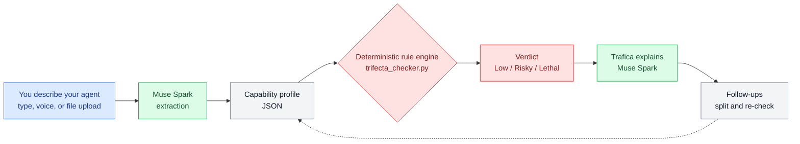

# Trifecta Checker

[English](README.md) · [日本語](README.ja.md) · [中文](README.zh.md) · [हिन्दी](README.hi.md) · [Español](README.es.md) · **한국어**

**AI 에이전트를 위한 비행 전 안전 점검.** 에이전트가 할 수 있는 일을 설명해 보세요 —
Trifecta Checker가 그 능력 조합이 안전한지, 왜 그런지,
그리고 안전하지 않다면 어떻게 나누어야 하는지 알려줍니다.

Meta Global AI Developer Hackathon(2026년 10월–11월)을 위해 제작되었습니다.

<p align="center">
  
  <br>
  <sub>Trafica, the Trifecta Checker mascot</sub>
</p>

**라이브 데모:** https://meta-global-ai-hackathon-trifecta-c.vercel.app/


## 사용 모습

친근한 체커 캐릭터인 **Trafica**와 대화하면 됩니다 — 양식도,
보안 용어도 필요 없습니다:

1. **에이전트에 대해 자신의 말로 설명하세요.** 입력하거나, 🎤를 눌러 말하거나,
   +를 눌러 파일을 불러오세요: 일반 텍스트 설명문, 또는 **MCP
   설정 JSON** — 서버들이 설명문으로 요약되어
   그대로 검사됩니다(`fixtures/sample_mcp_config.json`을试试해 보세요).
2. **쉬운 말로 판정을 받으세요** — Low, Risky 또는 Lethal — 그 근거가 된 능력들과
   무엇이 잘못될 수 있고 어떻게 고쳐야 하는지에 대한 일상적인 설명과 함께.
3. **판정을 바꿀 수 있는 세부 사항이 있으면, Trafica가 추측 대신 질문 하나를 되묻습니다.**
   탭으로 답하거나 직접 입력하세요.
4. **계속 대화하세요.** "나누면 어떻게 돼?"라고 물어보면 Trafica가 나눈 모습을 보여줍니다 —
   읽기 전용 Reader와 승인 기반으로 동작하는 Sender — 각 절반에 대한
   새로운 판정과 함께.

전체 대화는 영어, 일본어, 중국어,
힌디어, 스페인어, 한국어의 6개 언어로 동작합니다.

## 아이디어: 치명적 트리펙타

에이전트는 세 가지 능력이 한곳에 모일 때 위험해집니다:

1. **사적인 데이터를 읽습니다**(메일, 파일, 캘린더…)
2. **신뢰할 수 없는 콘텐츠를 읽습니다**(메시지 본문, 웹 페이지, 업로드 — 공격자가
   지침을 심을 수 있는 곳)
3. **데이터를 외부로 보낼 수 있습니다**(메일 보내기, 메시지 게시, 외부 API 호출)

세 가지가 모두 갖춰지면, 오염된 메시지 하나로 에이전트를 속여
데이터를 유출하게 만들 수 있습니다: Simon Willison이 *lethal trifecta*라고 부른 패턴입니다. Meta의
"Agents Rule of Two"도 플랫폼 측면에서 같은 점을 말합니다: 하나의 세션에서는
세 가지 중 최대 두 가지만 가지라는 것입니다.

Trifecta Checker는 에이전트 프로필을 다음과 같이 평가합니다:

| 판정 | 의미 |
|---|---|
| **Lethal** | 세 가지 요소가 모두 존재함 |
| **Risky** | 두 가지 요소, 또는 한 가지 요소와 위험 증폭 요소가 함께 존재함 |
| **Low** | 한 가지 이하의 요소만 있고, 증폭 요소가 없음 |

증폭 요소: **사람의 승인 없이** 행동하기, 코드 **자동 실행**,
그리고 **장기 기억에 쓰기**.

## 작동 방식

```
description ──▶ extraction ──▶ rule engine ──▶ explanation
               (Muse Spark)    (deterministic)  (Muse Spark)
```

같은 흐름을 다이어그램으로 나타내면 다음과 같습니다:



- **판정은 절대 LLM에서 나오지 않습니다.** 작은 결정적 규칙 엔진
  (`trifecta_checker.py`)이 평가 규칙을 적용하므로, 같은 프로필은
  항상 같은 판정을 받습니다. 그 재현성이 핵심입니다.
- **Muse Spark의 역할은 번역입니다**: 자유 텍스트 설명문을
  엔진의 구조화된 프로필로 바꾸고, 판정을 하나의 구체적인 공격 시나리오와 해결책과 함께
  6개 언어의 쉬운 말로 되돌려 주고,
  판정 이후의 후속 대화를 이어갑니다.
- **추출 결과는 검증됩니다.** 엔진은 닫힌 어휘를 사용합니다. 모델이
  없는 토큰을 만들어내면, 허용된
  어휘와 함께 출력을 한 번 돌려보내고(*repair call*), 그래도 맞지 않으면
  추측하지 않고 추출 실패로 Loud하게 알립니다. 설명문에 열려 있는 부분은
  보고되며, UI는 판정을 바꿀 수 있는 한 가지에 대해 묻습니다.

이 분리는 Meta 해커톤 워크숍
"Agents 102: Best Practices for Verifiable Agents Pt. 2"(Yash Khare,
Meta 파트너 엔지니어)가 검증 가능한 에이전트를 위해 가르치는 패턴과 같습니다: 검증을
선택적 단계가 아닌 도구에 내장하기,
LLM은 판단이 필요한 곳에만 두고 결정적 검사를 먼저 하기,
그리고 사람의 승인을 필수 게이트로 두기. 워크숍의
데모 메모 자체가 검증을 통과하지 못했습니다 — 이런 분리가
일찍 잡아내기 위해 존재하는 종류의 실수입니다.

모든 판정에는 근거(어떤 능력이 어떤 요소를 만들었는지)와 **분리 제안**이 함께 제공됩니다: 읽기 전용 Reader와
허용 목록에 있는 대상으로 사람이 승인한 텍스트만 보내는 Sender로 나누는 것입니다. 샘플에는
"나눈 뒤" 상태가 포함되어 있으므로, 검사를 다시 실행하고 Lethal
설정이 더 안전한 두 절반으로 바뀌는 것을 확인할 수 있습니다.

## 빠른 시작

```bash
# The engine alone — no API key needed
python3 trifecta_checker.py
python3 tests/test_engine.py   # reproducibility + boundary tests (8 cases, no LLM)

# Full pipeline (needs access to the Meta Model API)
python3 extract.py --file fixtures/case_c.txt     # description -> verdict
python3 check.py   --file fixtures/case_c.txt --lang en

# Web UI (stdlib only)
python3 app.py 8765   # http://127.0.0.1:8765/
```

## 샘플

| 케이스 | 설정 | 예상 결과 |
|---|---|---|
| A `case_a.txt` | 네트워크 없는 로컬 메모 요약기 | Low |
| B `case_b.txt` | 메일 + 웹을 읽지만, 보낼 수는 없음 | Risky |
| C `case_c.txt` | 스스로 보내고 스크립트를 실행하는 메일 에이전트 | Lethal |
| D `case_d.txt` | 채팅 메시지를 보내는 일상 비서 | Lethal |
| C-fixed `case_c_fixed_reader.txt` | 분리 후: Reader | Risky |
| C-fixed `case_c_fixed_sender.txt` | 분리 후: 승인 기반 Sender | Low |

매니페스트는 `fixtures/fixtures.json`을 참조하세요.

## 솔직한 한계

- 이 평가는 표준이 아닌 **휴리스틱**입니다. 에이전트 설정에 대한 검증된 점수 공식은
  아직 존재하지 않습니다. 트리펙타 개수는 필요한
  검사이지, 충분한 검사는 아닙니다.
- 트리펙타 패턴은 주로 **데이터 탈취**에 관한 것입니다. 에이전트는 다른 방식으로도 안전하지 않을 수 있으며
  (나쁜 도구, 약한 샌드박스, 지나치게 넓은 승인) 이 검사는 이를 다루지 않습니다 — 더 넓은 지도는
  OWASP Top 10 for Agentic Applications를 참조하세요.
- 추출 품질은 설명문에 따라 달라집니다. 모호한 설명문은 모호한 프로필을 만듭니다.
  검사기는 중요한 빈틈에 대해 되묻지만, 정직하고 구체적인 설명문이
  여전히 가장 신뢰할 수 있는 판정을 제공합니다.

## 참고 자료

- Simon Willison, *The lethal trifecta for AI agents* (2025-06-16) —
  https://simonwillison.net/2025/Jun/16/the-lethal-trifecta/
- Meta, *Agents Rule of Two* (2025-10-31) —
  https://ai.meta.com/blog/practical-ai-agent-security/
- OWASP, *Top 10 for Agentic Applications for 2026* —
  https://genai.owasp.org/resource/owasp-top-10-for-agentic-applications-for-2026/

## 사용 기술

- 추출과 설명을 위한 **Muse Spark**(Meta Model API)
- 결정적 Python 규칙 엔진(이 저장소, 행사 기간에 작성)
- 같은 저자의 이전 작업을 배경으로 인용: `ai-governance-control`
  (*개발* 환경에 대한 거버넌스 — 승인 게이트와
  fail-closed 설계). Trifecta Checker는 보완적인 런타임 측면입니다:
  이미 존재하는 에이전트 설정을 진단합니다.
