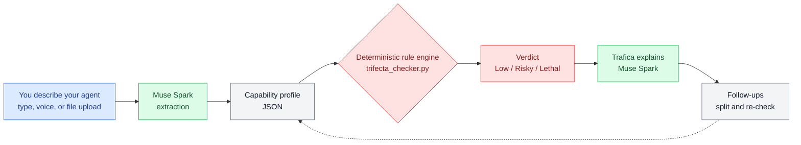

# Trifecta Checker

**English** · [日本語](README.ja.md) · [中文](README.zh.md) · [हिन्दी](README.hi.md) · [Español](README.es.md)

**A pre-flight safety check for AI agents.** Describe what your agent can do —
Trifecta Checker tells you whether that combination of powers is safe, why,
and how to split it up if it is not.

Built for the Meta Global AI Developer Hackathon (Oct–Nov 2026).

<p align="center">
  
  <br>
  <sub>Trafica, the Trifecta Checker mascot</sub>
</p>

**Live demo:** https://meta-global-ai-hackathon-trifecta-c.vercel.app/


## What it is like to use

You chat with **Trafica**, a friendly checker character — no forms, no
security vocabulary needed:

1. **Describe your agent in your own words.** Type it, tap 🎤 and talk, or
   tap + and load a file: a plain text description, or an **MCP
   configuration JSON** — its servers are summarized into a description
   and checked as-is (try `fixtures/sample_mcp_config.json`).
2. **Get a verdict in plain words** — Low, Risky or Lethal — with the powers
   behind it and an everyday-language explanation of what could go wrong
   and how to fix it.
3. **If a detail could change the verdict, Trafica asks one question back**
   instead of guessing. Answer with a tap or by typing.
4. **Keep talking.** Ask "what if I split it?" and Trafica shows the split —
   a read-only Reader and an approval-gated Sender — with fresh verdicts for
   each half.

The whole conversation works in five languages: English, Japanese, Chinese,
Hindi and Spanish.

## The idea: the lethal trifecta

An agent becomes dangerous when three powers meet in one place:

1. **It reads private data** (your mail, files, calendar…)
2. **It reads untrusted content** (message bodies, web pages, uploads — places
   where an attacker can plant instructions)
3. **It can send data out** (send mail, post messages, call external APIs)

With all three, a single poisoned message can talk the agent into leaking
your data: the pattern Simon Willison named the *lethal trifecta*. Meta's
"Agents Rule of Two" makes the same point from the platform side: hold at
most two of the three in one session.

Trifecta Checker rates an agent profile:

| Verdict | Meaning |
|---|---|
| **Lethal** | All three elements are present |
| **Risky** | Two elements, or one element plus a risk amplifier |
| **Low** | One element or fewer, no amplifiers |

Amplifiers: acting with **no human approval**, **auto-executing code**, and
**writing to long-term memory**.

## How it works

```
description ──▶ extraction ──▶ rule engine ──▶ explanation
               (Muse Spark)    (deterministic)  (Muse Spark)
```

The same flow, as a diagram:



- **The verdict never comes from an LLM.** A small deterministic rule engine
  (`trifecta_checker.py`) applies the rating rules, so the same profile
  always gets the same verdict. That reproducibility is the point.
- **Muse Spark's job is translation**: turning a free-text description into
  the engine's structured profile, turning the verdict back into plain
  language in five languages with one concrete attack scenario and a fix,
  and carrying the follow-up conversation after the verdict.
- **Extraction is validated.** The engine has a closed vocabulary. If the
  model invents a token, the output is sent back once with the allowed
  vocabulary (a *repair call*); if it still does not fit, extraction fails
  loudly instead of guessing. Aspects the description leaves open are
  reported back, and the UI asks about the one that could change the
  verdict.

This split follows the same pattern Meta's hackathon workshop
"Agents 102: Best Practices for Verifiable Agents Pt. 2" (Yash Khare,
Meta partner engineer) teaches for verifiable agents: verification
built into the tool rather than offered as an optional step,
deterministic checks first with the LLM judging only where judgment
is needed, and human approval as a mandatory gate. The workshop's
own demo memo failed verification — the kind of mistake this split
exists to catch early.

Every verdict ships with its evidence (which capability produced which
element) and a **separation proposal**: split into a read-only Reader and a
Sender that only sends human-approved text to an allowlist. The samples
include the "after" state, so you can re-run the check and watch a Lethal
setup become two safer halves.

## Quickstart

```bash
# The engine alone — no API key needed
python3 trifecta_checker.py
python3 tests/test_engine.py   # reproducibility + boundary tests (8 cases, no LLM)

# Full pipeline (needs access to the Meta Model API)
python3 extract.py --file fixtures/case_c.txt     # description -> verdict
python3 check.py   --file fixtures/case_c.txt --lang en

# Web UI (stdlib only)
python3 app.py 8765   # http://127.0.0.1:8765/
```

## Samples

| Case | Setup | Expected |
|---|---|---|
| A `case_a.txt` | Local memo summariser, no network | Low |
| B `case_b.txt` | Reads mail + web, cannot send | Risky |
| C `case_c.txt` | Mail agent that sends on its own and runs scripts | Lethal |
| D `case_d.txt` | Everyday assistant that sends chat messages | Lethal |
| C-fixed `case_c_fixed_reader.txt` | After the split: the Reader | Risky |
| C-fixed `case_c_fixed_sender.txt` | After the split: the approved Sender | Low |

See `fixtures/fixtures.json` for the manifest.

## Honest limitations

- The rating is a **heuristic**, not a standard. No validated scoring formula
  for agent configurations exists yet; the trifecta count is a necessary
  check, not a sufficient one.
- The trifecta pattern is mainly about **data theft**. Agents can be unsafe
  in other ways (bad tools, weak sandboxes, over-broad approvals) that this
  check does not cover — see the OWASP Top 10 for Agentic Applications for
  the wider map.
- Extraction quality depends on the description. Vague descriptions produce
  vague profiles; the checker asks back about the gaps that matter, but an
  honest, specific description still gives the most reliable verdict.

## References

- Simon Willison, *The lethal trifecta for AI agents* (2025-06-16) —
  https://simonwillison.net/2025/Jun/16/the-lethal-trifecta/
- Meta, *Agents Rule of Two* (2025-10-31) —
  https://ai.meta.com/blog/practical-ai-agent-security/
- OWASP, *Top 10 for Agentic Applications for 2026* —
  https://genai.owasp.org/resource/owasp-top-10-for-agentic-applications-for-2026/

## Built with

- **Muse Spark** (Meta Model API) for extraction and explanation
- A deterministic Python rule engine (this repo, written during the event)
- Prior work by the same author, cited as background: `ai-governance-control`
  (governance for the *development* environment — approval gates and
  fail-closed design). Trifecta Checker is the complementary runtime side:
  it diagnoses an agent configuration that already exists.
