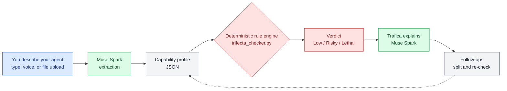

# Trifecta Checker

[English](README.md) · [日本語](README.ja.md) · **中文** · [हिन्दी](README.hi.md) · [Español](README.es.md) · [한국어](README.ko.md)

**AI 智能体的起飞前安全检查。**描述一下你的智能体能做什么——
Trifecta Checker 会告诉你这种能力组合是否安全、原因是什么，
以及如果不安全该如何拆分。

为 Meta Global AI Developer Hackathon（2026 年 10 月–11 月）打造。

<p align="center">
  
  <br>
  <sub>Trafica：三要素检查的吉祥物</sub>
</p>

**在线演示：** https://meta-global-ai-hackathon-trifecta-c.vercel.app/


## 使用体验

你将与友好核查员 **Trafica** 对话——无需填表，也不需要安全词汇：

1. **用自己的话描述你的智能体。**可以直接输入，点击 🎤 语音输入，或点击 + 加载文件：纯文本描述，或 **MCP 配置 JSON**——其中的服务器会被汇总成一段描述并按原样检查（可以试试 `fixtures/sample_mcp_config.json`）。
2. **用直白的语言获得结论**——Low（低）、Risky（有风险）或 Lethal（致命）——附带背后的能力组合，以及用日常语言解释可能出什么问题、该怎么修。
3. **如果某个细节可能改变结论，Trafica 会反问你一个问题**，而不是瞎猜。点一下或打字回答即可。
4. **继续聊下去。**问“如果我拆开呢？”，Trafica 会展示拆分方案——一个只读的 Reader 和一个需审批的 Sender——并给出每一半的新结论。

整个对话支持六种语言：英语、日语、中文、印地语、西班牙语和韩语。

## 核心理念：lethal trifecta

当三种能力集中在一处时，智能体就会变得危险：

1. **它能读取隐私数据**（你的邮件、文件、日历……）
2. **它能读取不可信内容**（消息正文、网页、上传文件——攻击者可以藏指令的地方）
3. **它能向外发送数据**（发邮件、发消息、调用外部 API）

三者齐备时，一条被投毒的消息就能哄骗智能体泄露你的数据：这就是 Simon Willison 所说的 *lethal trifecta* 模式。Meta 的“Agents Rule of Two”从平台角度讲了同样的道理：一次会话中最多持有三者中的两项。

Trifecta Checker 会给智能体画像打分：

| 结论 | 含义 |
|---|---|
| **Lethal** | 三个要素齐备 |
| **Risky** | 具备两个要素，或一个要素外加风险放大器 |
| **Low** | 只有一个或零个要素，且无放大器 |

放大器：**无人审批就行动**、**自动执行代码**和**写入长期记忆**。

## 工作原理

```
description ──▶ extraction ──▶ rule engine ──▶ explanation
               (Muse Spark)    (deterministic)  (Muse Spark)
```

同样的流程，用图表示如下：



- **结论绝不来自 LLM。**小而确定的规则引擎（`trifecta_checker.py`）负责执行评分规则，所以同一份画像永远得到同一结论。可复现正是关键所在。
- **Muse Spark 的工作是转换**：把自由文本描述转成引擎用的结构画像，把结论转回六种语言的直白解释（包含一个具体的攻击场景和修复办法），并在结论之后继续陪你对话。
- **提取结果会经过校验。**引擎使用封闭词汇表。如果模型编造了词汇，输出会被附上允许的词汇表退回一次（*repair call*，修复调用）；如果仍然不符合，就明确报错失败，而不是瞎猜。描述中没讲清的地方会被标出来，界面会就其中可能改变结论的一项向你追问。

这种分工沿用了 Meta 黑客松工作坊“Agents 102: Best Practices for Verifiable Agents Pt. 2”（Yash Khare，Meta 合作工程师）中讲的可验证智能体模式：把验证做进工具里，而不是作为可选项，确定性检查先行，只在需要判断的地方用 LLM，并把人工审批作为强制关卡。工作坊自己的演示备忘录就没通过验证——正是这种分工要早早抓住的那类错误。

每个结论都附带证据（哪项能力对应哪个要素）和一份**拆分建议**：拆成只读的 Reader，和只向允许名单发送人工审批文本的 Sender。示例中包含拆分后的“之后”状态，你可以重新跑一遍检查，看一个 Lethal 配置如何变成两个更安全的 halves。

## 快速上手

```bash
# The engine alone — no API key needed
python3 trifecta_checker.py
python3 tests/test_engine.py   # reproducibility + boundary tests (8 cases, no LLM)

# Full pipeline (needs access to the Meta Model API)
python3 extract.py --file fixtures/case_c.txt     # description -> verdict
python3 check.py   --file fixtures/case_c.txt --lang en

# Web UI (stdlib only)
python3 app.py 8765   # http://127.0.0.1:8765/
```

## 示例

| 案例 | 配置 | 预期结论 |
|---|---|---|
| A `case_a.txt` | 本地备忘录摘要工具，无联网 | Low |
| B `case_b.txt` | 能读邮件和网页，不能发送 | Risky |
| C `case_c.txt` | 能自己发邮件、跑脚本的邮件智能体 | Lethal |
| D `case_d.txt` | 能发聊天消息的日常助手 | Lethal |
| C-fixed `case_c_fixed_reader.txt` | 拆分后：Reader | Risky |
| C-fixed `case_c_fixed_sender.txt` | 拆分后：经审批的 Sender | Low |

清单见 `fixtures/fixtures.json`。

## 如实说明的局限

- 评分是**启发式方法**，不是标准。目前还没有经过验证的智能体配置评分公式；三要素计数是必要检查，而非充分检查。
- 三要素模式主要针对**数据窃取**。智能体还可能以其他方式不安全（有问题的工具、不牢的沙箱、过宽的审批），本检查不覆盖——更全的图景可参考 OWASP Agentic Applications Top 10。
- 提取质量取决于描述。含糊的描述会产出含糊的画像；核查员会就关键缺口反问，但诚实、具体的描述仍能给出最可靠的结论。

## 参考资料

- Simon Willison, *The lethal trifecta for AI agents* (2025-06-16) —
  https://simonwillison.net/2025/Jun/16/the-lethal-trifecta/
- Meta, *Agents Rule of Two* (2025-10-31) —
  https://ai.meta.com/blog/practical-ai-agent-security/
- OWASP, *Top 10 for Agentic Applications for 2026* —
  https://genai.owasp.org/resource/owasp-top-10-for-agentic-applications-for-2026/

## 构建技术

- **Muse Spark**（Meta Model API），用于提取和解释
- 确定性 Python 规则引擎（本仓库，在活动期间编写）
- 同一作者的先前作品，作为背景引用：`ai-governance-control`（面向*开发*环境的治理——审批关卡和 fail-closed 设计）。Trifecta Checker 是互补的运行时一侧：诊断已经存在的智能体配置。
